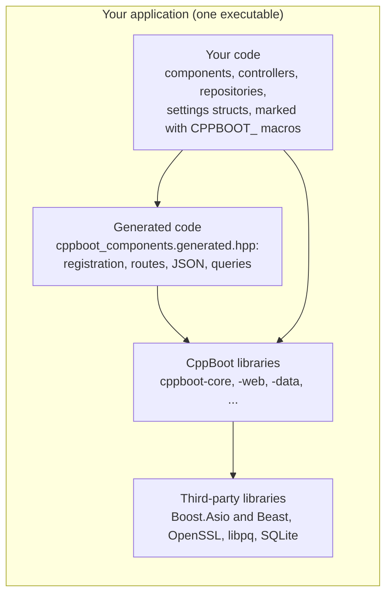
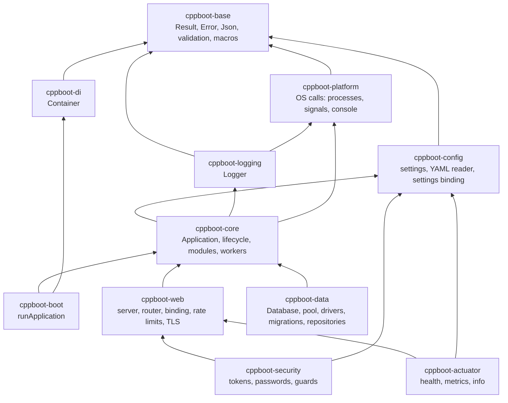
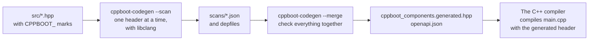
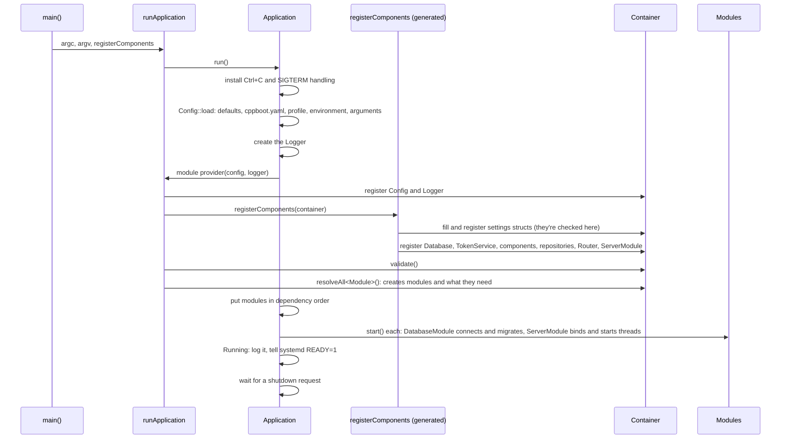
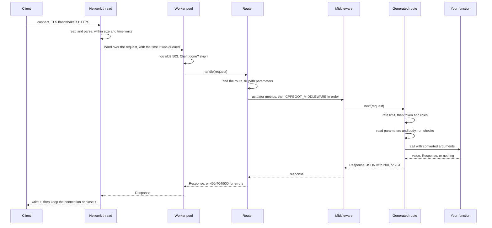
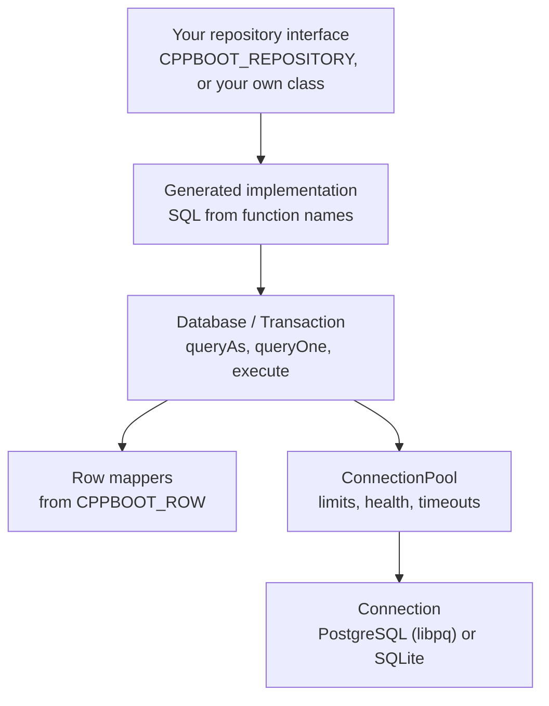
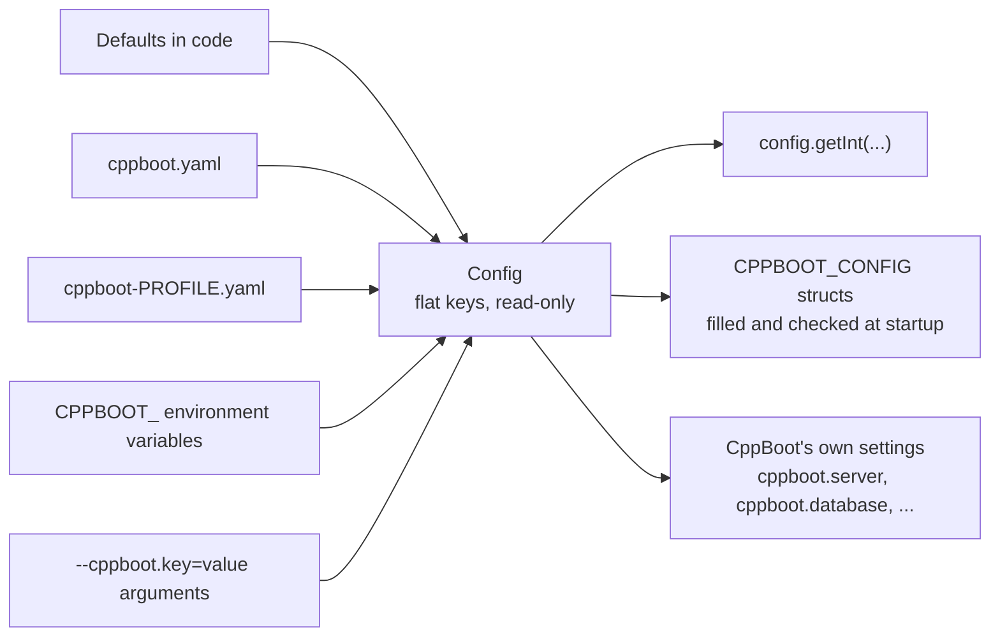

# How CppBoot works

This guide explains CppBoot as a whole: what an application is made of, what happens when it's built, when it starts, when a request arrives and when it stops, and where each decision is recorded. It's for anyone who works on CppBoot, or wants to know what their application is doing underneath.

The numbered records in this folder, such as [004](004-dependency-injection.md), each explain one decision and why it was made. This guide connects them. When the two seem to disagree, the record is the more detailed and more recent one, and this guide should be fixed.

## Contents

1. [The big picture](#1-the-big-picture)
2. [Libraries](#2-libraries)
3. [Three moments: build, startup and request](#3-three-moments-build-startup-and-request)
4. [Build time](#4-build-time)
5. [Startup](#5-startup)
6. [A request](#6-a-request)
7. [Shutdown](#7-shutdown)
8. [Data access](#8-data-access)
9. [Settings](#9-settings)
10. [Threads](#10-threads)
11. [Errors](#11-errors)
12. [Extension points](#12-extension-points)
13. [The SDK and its tools](#13-the-sdk-and-its-tools)
14. [Principles](#14-principles)
15. [Records](#15-records)

## 1. The big picture

An application built with CppBoot is one executable, made from four kinds of code:



- **Your code** is ordinary C++. Marks such as `CPPBOOT_SERVICE` compile to nothing; they only tell the generator what to do.
- **Generated code** is written by `cppboot-codegen` while the project builds. It's one header, included by `main.cpp`, that creates and connects everything. Nothing is discovered at runtime.
- **CppBoot's libraries** are static libraries, linked in.
- **Third-party libraries** are hidden behind CppBoot's own types, so none of them appears in a public header.

`main.cpp` in every new project is three lines:

```cpp
int main(int argc, char* argv[]) {
    return cppboot::runApplication(argc, argv, cppboot::generated::registerComponents);
}
```

`runApplication` runs the lifecycle, and `registerComponents` is the generated function that tells it what the application contains.

## 2. Libraries

Each library is a CMake target in `framework/`. A library may only depend on the ones below it.



| Library | What it holds | Third-party, kept private |
|---|---|---|
| `cppboot-base` | `Result<T>`, `Error`, `Exception`, `cppboot::Json`, the checks behind `CPPBOOT_RANGE` and others, and every `CPPBOOT_` macro | None |
| `cppboot-platform` | Every operating system call: environment, processes, signals, console, socket state, systemd notification. The rest of CppBoot uses only its interfaces ([007](007-platform-abstraction.md)) | Win32 or POSIX |
| `cppboot-config` | `Config`, its sources and precedence, the YAML reader, and `SettingsBinder` for settings structs ([017](017-configuration.md)) | None |
| `cppboot-logging` | `Logger`, which writes to the console and a file | None |
| `cppboot-core` | `Application`, the lifecycle, `Module`, `ModuleManager`, `WorkerGroup` and `ApplicationContext` ([002](002-core-runtime.md), [003](003-module-system.md)) | None |
| `cppboot-di` | `Container`, `Deps<...>` and scopes ([004](004-dependency-injection.md)) | None |
| `cppboot-boot` | `runApplication`, which connects the container to the application | None |
| `cppboot-web` | `Server`, `ServerModule`, `Router`, `Request`, `Response`, JSON binding, rate limits and TLS ([010](010-web-server.md), [014](014-rate-limiting.md), [015](015-https.md)) | Boost.Asio, Boost.Beast, OpenSSL |
| `cppboot-data` | `Database`, `Transaction`, `ConnectionPool`, drivers, migrations and repository support ([011](011-data-access.md)) | libpq, SQLite |
| `cppboot-security` | `TokenService`, password hashing, and the checks that generated routes call ([012](012-security.md)) | OpenSSL |
| `cppboot-actuator` | Health checks, metrics and info ([013](013-observability.md)) | None |

Two tools sit beside the libraries, in `tools/`:

| Tool | What it does |
|---|---|
| `cppboot-codegen` | Reads marked headers with libclang and writes the generated header and `openapi.json` ([009](009-code-generation.md)) |
| `cppboot` | The command-line tool: create, add, build, run, dev, test, package, openapi, doctor ([019](019-cli-and-sdk.md)) |

The core works without the web server or a database, so the same runtime serves a REST API, a background service and a command-line tool. A project links only the libraries it uses: one made with `cppboot create` without `--web` doesn't link Boost or OpenSSL at all.

## 3. Three moments: build, startup and request

Most of CppBoot's design comes from moving work as early as it can go:

| Moment | What happens | What a mistake becomes |
|---|---|---|
| **Build** | The generator reads your marks, checks them, and writes code for registration, routes, JSON, queries, settings and checks | A build error with a file and line |
| **Startup** | Settings are read and checked, components are created, the database is connected and migrated, and the server binds its port | Exit code 78 for settings, 1 for anything else, before any request is served |
| **Request** | Generated code converts, checks and calls your function | A response with a status: 400, 401, 403, 404, 413, 429, 500 or 503 |

A missing dependency, a route that can't work, a repository function whose name refers to a field that doesn't exist, or a check that can't apply to its field never reaches a running application. A wrong setting never reaches the first request.

## 4. Build time

### From marks to code



1. **Scan.** For each header in `src`, the build runs `cppboot-codegen --scan`. It parses the header with libclang, using the target's own include folders, definitions and options, and with `CPPBOOT_CODEGEN` defined, which turns each mark into a `[[clang::annotate]]` attribute it can read. It saves what it found as JSON, and a depfile that lists every file the header included.
2. **Merge.** `cppboot-codegen --merge` reads every scan, checks them together, and writes the generated header and `openapi.json`.
3. **Compile.** `main.cpp` includes the generated header, so the compiler checks the generated code as it checks yours.

Because each header has its own scan and depfile, changing one header reads only that header again, and the merge is quick. [009](009-code-generation.md#build-steps) has the details.

### What the generator reads, and what it writes

| You write | The generator writes |
|---|---|
| `CPPBOOT_SERVICE` on a class | `container.registerSingleton<T>(Deps<...>{})`, with the constructor's parameters as dependencies, and a binding for each abstract base |
| `CPPBOOT_CONTROLLER` and `CPPBOOT_GET`, `_POST` and so on | A `Router` with a lambda for each route, which reads parameters, checks them, calls the function and converts the result |
| `CPPBOOT_MIDDLEWARE(order)` | `router->use(...)`, in order |
| `CPPBOOT_PUBLIC`, `CPPBOOT_ROLE`, `CPPBOOT_RATE_LIMIT` | Token and role checks, and a rate limiter, inside each route's lambda |
| `CPPBOOT_JSON` on a struct | A `cppboot::JsonConvert<T>` specialization, with its checks ([018](018-json.md)) |
| `CPPBOOT_ROW` on a struct | A row mapper, registered with the `Database` |
| `CPPBOOT_CONFIG("prefix")` on a struct | Code that fills it from settings at startup and registers it ([017](017-configuration.md)) |
| `CPPBOOT_REPOSITORY("table")` on an interface | A class that implements each function with the SQL its name describes ([011](011-data-access.md)) |
| Checks such as `CPPBOOT_RANGE` | Calls to `cppboot::validation` where the value is read, with the message written out |
| All of the routes | The OpenAPI document, as `openapi.json` and as `kOpenApi` in the header |

### What the build rejects

The generator checks the whole program, across headers, before it writes anything:

- A dependency that nothing provides, two providers of one type, or a dependency cycle.
- A component with more than one public constructor, or a constructor parameter that isn't a reference or `std::shared_ptr` to a component.
- A component field that points at a request, which ends before the component does ([016](016-ownership.md)).
- Two routes that match the same requests, a path parameter with no function parameter, or a security mark on something that isn't a route.
- A check that can't apply to its field, or a check where nothing would run it.
- Two settings structs with the same prefix.
- A repository function whose name refers to a field that doesn't exist, compares a field with a parameter of another kind, or returns a type that doesn't fit.

It also warns, without stopping the build, about patterns that are usually mistakes, such as a field that can change in a component with no lock.

## 5. Startup



The lifecycle states are `Initialized`, `Configuring`, `RegisteringModules`, `CreatingContext`, `Starting`, `Running`, `Stopping` and `Terminated`, with `Failed` reachable from any state before `Running` ([002](002-core-runtime.md#lifecycle)).

Where startup can fail, and how the application exits:

| Step | A failure such as | Exit code |
|---|---|---|
| Reading settings | Invalid YAML, a profile file that's missing, an environment variable matching two keys | 78 |
| Creating the logger | An unknown log level, a log file that can't be opened | 78 |
| Filling settings structs | A missing required setting, a wrong type, a failed check, an unknown key | 78 |
| Creating components | A missing secret for tokens, a constructor that throws | 1 |
| Starting modules | A database that can't be reached, a migration that fails, a port in use | 1 |

Everything above happens on the main thread. The server starts its threads last, so by the time a request can arrive, every component it could reach already exists ([006](006-concurrency-model.md#startup-is-single-threaded)).

## 6. A request



Step by step:

1. **Network thread.** One of a few network threads owns the connection for its whole life, so its state needs no locks. It reads the request with Boost.Beast and enforces the limits: body size (413), header size, a slow client (closed), too many connections (closed). With HTTPS, the TLS handshake also runs here ([010](010-web-server.md#threads), [015](015-https.md)).
2. **Worker pool.** The request goes to a pool with one thread per core, so a handler that blocks, for example on a database, doesn't stop other connections. A request that waited longer than `queue_timeout` gets 503 without running, and one whose client has gone is skipped ([010](010-web-server.md#overload)).
3. **Router.** It finds the route by method and path. A fixed segment beats a parameter, whatever the order they were added in.
4. **Middleware.** The actuator's metrics come first when it's on, so they measure everything else. Then each `CPPBOOT_MIDDLEWARE`, lowest order first. Each can return a response itself, or call `next`.
5. **The generated route** does, in this order:
   - the rate limit, first, so that it also limits attempts to guess a token;
   - the token and role checks, unless the route is public;
   - reading path and query parameters, converting them, and running their checks;
   - reading the body as JSON into the parameter's struct, which runs the struct's checks;
   - calling your function.
6. **The result** becomes a response: a value as JSON with 200, or with the status of a `WithStatus`; `void` as 204; a `Response` as it is.
7. **Errors** become responses here too: an `HttpError` with its status, a parameter or body that doesn't fit with 400 and the field's name, and anything else with 500 and a generic message, while the details go to the log.
8. **Back on the network thread**, the response is written. The connection stays open for the next request unless the client or shutdown says otherwise.

A request never touches another request's data: it moves between threads as a value, and the network thread doesn't touch the connection while a worker has it ([005](005-memory-management.md#values-crossing-threads)).

## 7. Shutdown

A shutdown request comes from Ctrl+C, SIGINT or SIGTERM, from `requestShutdown()`, or from a background worker that failed.

1. The application leaves `Running`, logs that it's shutting down, and tells systemd `STOPPING=1`.
2. Modules stop in the reverse of their start order. The server stops accepting, lets running requests finish for up to `shutdown_timeout`, then asks handlers to stop through `Request::stopToken()`, and waits for its threads ([010](010-web-server.md#shutdown)).
3. Background workers are asked to stop, and joined.
4. Components are destroyed in the reverse of their creation order, so nothing is destroyed while something that uses it still exists ([016](016-ownership.md)).
5. The logger is flushed, and the process exits with 0, or 1 if a worker failed.

Nothing is ever killed from inside: stopping is cooperative everywhere, through `std::stop_token` ([006](006-concurrency-model.md#stopping)).

## 8. Data access



- **A repository** is either your own class that takes `Database&`, or an interface whose functions the generator writes from their names, such as `findByAuthorOrderByPriceDesc`.
- **`Database`** runs statements. Values always go separately from the SQL, as `$1`, `$2`, for both drivers, which is what rules out SQL injection.
- **Each statement borrows a connection** from the pool for as long as it runs, so a `Database` is safe from any thread. A transaction keeps its connection until it commits or rolls back.
- **Rows become structs** through mappers that the generator writes for `CPPBOOT_ROW`, matching columns to fields by name.
- **Migrations** run at startup from `db/migrations`, in number order, each in its own transaction, and a changed file that was already applied stops startup.

[011](011-data-access.md) covers the pool, transactions, migrations and drivers.

## 9. Settings



Each source overrides the ones to its left. `Config` holds flat keys such as `cppboot.server.port`, and never changes after startup, so any thread can read it. Settings structs are the typed way to read your own settings: the generator writes the code that fills them, and every problem stops startup with exit code 78. [017](017-configuration.md) explains the reader, the precedence and the binding.

## 10. Threads

| Thread | Started by | Does |
|---|---|---|
| Main | The operating system | The whole lifecycle, then waits for shutdown |
| Network threads | The server, 1 to 4 by default | Reading and writing connections, TLS |
| Handler workers | The server, one per core by default | Middleware and your route functions |
| Module workers | `context.workers().spawn()` | Background work that a module starts |

Components are created once and shared by every handler thread, so a component that changes its own state needs a lock. Everything CppBoot gives you, such as `Config`, `Logger`, `Database` and `Metrics`, is safe from any thread. [006](006-concurrency-model.md) has the full model.

## 11. Errors

CppBoot uses three ways to report a failure, each for one kind:

| Kind | How | Example |
|---|---|---|
| Expected, and the caller decides what to do | `Result<T>` with an `Error` | A settings file that doesn't parse, a process that won't start |
| A client's mistake, during a request | `HttpError(status, message)` | A missing record, 404 |
| A bug, or something that makes continuing impossible | `cppboot::Exception`, or any exception | A missing component, an invalid state |

Where each ends up:

| Where it happens | What the outside sees |
|---|---|
| At build time, in the generator | A build error with the file, line and what's wrong |
| While reading settings, or filling settings structs | `ErrorCode::InvalidConfiguration`, then exit code 78 |
| Anywhere else in startup | Exit code 1, with the error logged |
| In a route: `HttpError` | That status, with its message as JSON |
| In a route: a parameter or body that doesn't fit | 400, naming the parameter or field |
| In a route: any other exception | 500 with a generic message, and the details in the log |
| In a background worker | The application shuts down, and exits with 1 |

## 12. Extension points

What you add to an application, and what connects it:

| To add | Write | Connected by |
|---|---|---|
| Business logic | A class marked `CPPBOOT_SERVICE` | The generator, from its constructor |
| Something that starts and stops | A component that derives from `cppboot::Module` | The generator, into the module group |
| Routes | A class marked `CPPBOOT_CONTROLLER`, with marked functions | The generator, into the router |
| Code around every request | A class marked `CPPBOOT_MIDDLEWARE(order)` | The generator, into the router |
| Typed settings | A struct marked `CPPBOOT_CONFIG("prefix")` | The generator, filled at startup |
| Queries | An interface marked `CPPBOOT_REPOSITORY("table")`, or your own class | The generator writes and registers the interface's class |
| A health check | A component that derives from `HealthIndicator` | The generator, into the actuator |
| A database | A class that implements `cppboot::data::Connection` | `Database`, through a `ConnectionFactory` |
| Everything, by hand | `Container` registrations and `Router` routes | Your own `main.cpp`, with no generator ([004](004-dependency-injection.md), [web guide](../guides/web.md#defining-routes-by-hand)) |

`cppboot add` writes a starting point for most of these.

## 13. The SDK and its tools

An installed SDK is a folder:

```text
bin/                  cppboot, cppboot-codegen
include/cppboot/      public headers
lib/                  static libraries
lib/cmake/CppBoot/    CppBootConfig.cmake, cppboot_generate_components()
lib/cppboot/          Clang's headers for the generator, and build-info.txt
share/doc/cppboot/    licenses
```

A project finds it with `find_package(CppBoot)`. The installers set up the compiler and libraries, download the SDK, check it against its checksums and run `cppboot doctor`. The `cppboot` tool runs CMake and Ninja for you, keeps a build folder for each sanitizer, and packages a release with a systemd service. [019](019-cli-and-sdk.md) explains each command and the installers.

## 14. Principles

These run through every part of CppBoot, and each record follows them:

- **Build time before runtime.** What can be checked when building is, and generated code does what reflection would do elsewhere.
- **Fail closed.** A wrong setting stops startup. Nothing falls back to running less safely, such as without HTTPS or without a secret ([008](008-security-architecture.md)).
- **A mark that does nothing is an error.** It would look like protection or validation that isn't there.
- **Deny by default.** Routes need a token once a project uses security, servers listen on `127.0.0.1`, and `/openapi.json` and metrics are off or local unless turned on.
- **Bounded.** Everything that grows with what a client sends has a limit ([005](005-memory-management.md#bounded-memory)).
- **No global state**, except what the operating system's signal handling forces.
- **No third-party types in public headers.** JSON, settings and logging are CppBoot's own code, and the rest is hidden behind CppBoot's types.
- **Ordinary C++ for the developer.** No macros in function bodies, no base classes for components, and no ownership types to manage.

## 15. Records

| Record | About |
|---|---|
| [001](001-system-architecture.md) | The overall shape: libraries, layers, rules and scope |
| [002](002-core-runtime.md) | The lifecycle, exit codes, shutdown order and settings precedence |
| [003](003-module-system.md) | Modules: their contract, order and failure |
| [004](004-dependency-injection.md) | The container, lifetimes and why dependencies are declared |
| [005](005-memory-management.md) | Ownership, values between threads, and bounded memory |
| [006](006-concurrency-model.md) | Threads, what's shared, blocking and stopping |
| [007](007-platform-abstraction.md) | Where operating system code lives, and the differences |
| [008](008-security-architecture.md) | The security model as a whole |
| [009](009-code-generation.md) | The generator: how it reads, checks and writes |
| [010](010-web-server.md) | The server: threads, limits, overload and shutdown |
| [011](011-data-access.md) | Databases, pools, transactions and migrations |
| [012](012-security.md) | Tokens, passwords and protected routes |
| [013](013-observability.md) | Health, metrics and info |
| [014](014-rate-limiting.md) | Rate limits |
| [015](015-https.md) | HTTPS |
| [016](016-ownership.md) | Lifetimes of components, and the checks for risky fields |
| [017](017-configuration.md) | Settings: sources, the YAML reader and settings structs |
| [018](018-json.md) | CppBoot's own JSON, and how structs convert |
| [019](019-cli-and-sdk.md) | The command-line tool, the SDK and the installers |
